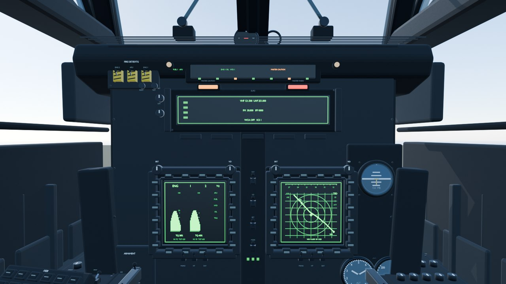
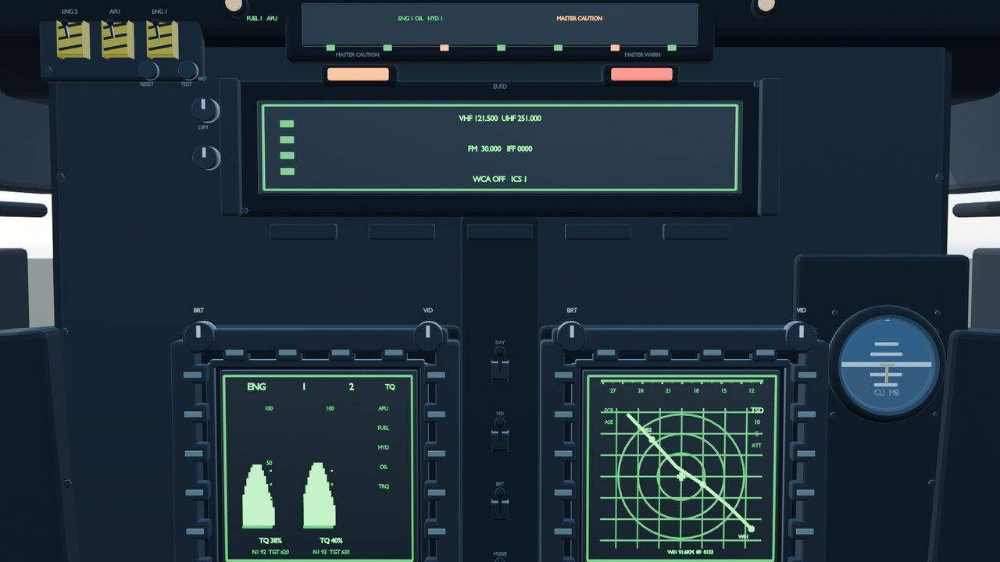
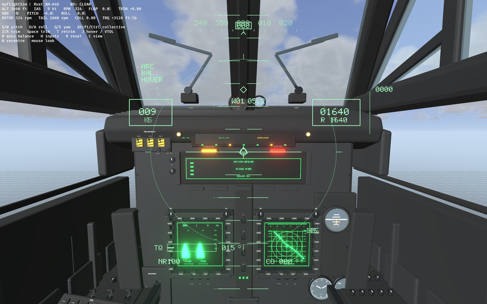
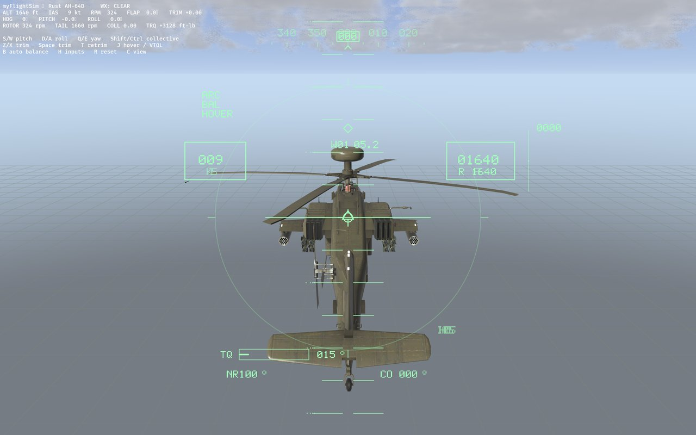
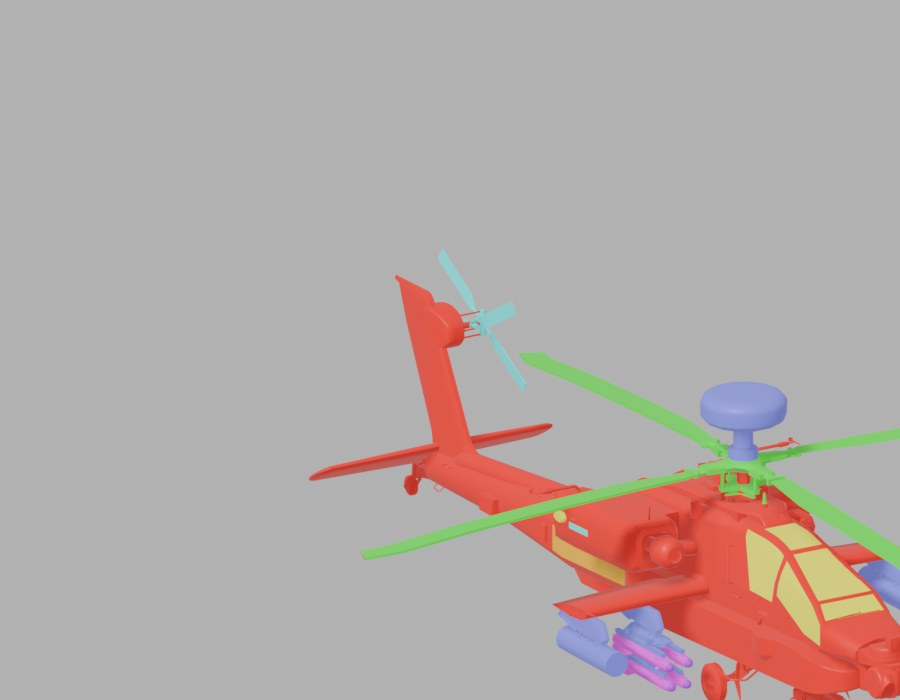

# myFlightSim

一个用 **Rust + Bevy** 写的飞行模拟器外壳，飞行力学默认由项目自带的**纯 Rust
FDM**（`crates/fdm`）驱动，设置 `FDM_BACKEND=jsbsim` 可切到 **JSBSim**。Bevy
负责渲染、相机、HUD 和输入；FDM 负责真正的气动与运动解算。默认模型是
`c172p`（Cessna 172P）。物理与画面之间由一个 `FlightModel` trait 隔开，见
「飞行模型后端」。

设计取向：**把 JSBSim 和机模已经提供的东西暴露出来就好**——能真实地飞起来
就停手，不去追 FlightGear 那种成熟的整机模拟。因此本项目的控件表是数据驱动的
（每机型一份档案，见 `src/aircraft_profile.rs`），机模定义了什么通道，我们就为
它声明什么控制。

## 飞行模型后端

物理与画面之间隔着一个 `FlightModel` trait（`crates/flight-model`）：它是一条
**命名属性总线**——App 往里写操纵指令（`fcs/elevator-cmd-norm` …）、读仪表
（`position/h-sl-ft`、`attitude/psi-rad` …），后端负责推进每一步。因此
`view`/`input`/HUD/自动驾驶完全不知道底下是谁在算。

- 默认后端是 **纯 Rust 引擎**（`crates/fdm`）：可配平、带街机模式，街机任务
  强制使用它。
- `FDM_BACKEND=jsbsim` 切到 **JSBSim**（`jsbsim-sys`），即原本的成熟物理；
  它的 `trim` 是空操作，也不认识街机模式。

属性名沿用 JSBSim 的拼写（完整契约见 `crates/flight-model/src/lib.rs`），
所以 JSBSim 后端几乎不需要翻译。

## 前置依赖

本项目**不自带** JSBSim，而是从一个本地源码检出（checkout）编译并链接：

- 一份 **JSBSim 源码**（需要同时提供编译产物与运行期数据目录
  `aircraft/`、`engine/`、`systems/`）
- **CMake**
- 支持 **C++17** 的编译器

`jsbsim-sys/build.rs` 会从该检出编译出 `libJSBSim.so`，链接到本地
`<target>/jsbsim-build/` 下（与具体 profile 无关，便于运行期通过 rpath 找到）。

### 指定 JSBSim 源码位置

按以下优先级解析（`build.rs` 与运行期 `jsbsim_sys::jsbsim_src` 逻辑一致）：

1. 环境变量 **`JSBSIM_SRC`**（若设置则必须有效，否则报错退出）；
2. 依次探测常见位置：`$HOME/gitrep/jsbsim`、`$HOME/jsbsim`、`$HOME/src/jsbsim`、
   `/usr/local/src/jsbsim`、`/opt/jsbsim`。

有效检出的判定标志是目录下存在 `src/FGFDMExec.h`。都找不到时会 panic，并列出
探测过的路径。推荐显式设置：

```sh
export JSBSIM_SRC=$HOME/gitrep/jsbsim
```

## 构建与运行

```sh
cargo run
```

首次运行会先编译 JSBSim（耗时较长），之后增量构建很快。左上角 HUD 显示空速、
高度、姿态、油门、转速等；按 `H` 可切换控制输入叠加层，按 `C` 在机外跟随与
座舱内视角之间切换（机模带内饰时才有座舱视角，见下）。

## 键位

| 按键 | 作用 | JSBSim 通道 |
| --- | --- | --- |
| `W` / `S` | 俯仰（抬头 / 低头） | `fcs/elevator-cmd-norm` |
| `D` / `A` | 横滚（右滚 / 左滚） | `fcs/aileron-cmd-norm` |
| `Q` / `E` | 偏航（左偏 / 右偏） | `fcs/rudder-cmd-norm` |
| `Shift` / `Ctrl` | 油门（固定翼）或总距（直升机） | `fcs/throttle-cmd-norm` / `fcs/collective-cmd-norm` |
| `Z` / `X` | 俯仰配平 | `fcs/pitch-trim-cmd-norm` |
| `F` / `V` | 襟翼放下 / 收起（固定翼） | `fcs/flap-cmd-norm` |
| `B` | 机轮刹车（松开回位） | `fcs/{left,right}-brake-cmd-norm` |
| `T` | 按当前状态重新配平（保留空速与位置） | — |
| `Y` | 重启到巡航（离地并按巡航配平） | — |
| `Space` | 直升机悬停配平（AH-64D 真实模式） | — |
| `J` | AH-64D 街机：自动悬停 / 垂直起降 / 降落 | `fcs/heli-hover-enable` |
| `B` | AH-64D 街机：自动平衡（松杆回平） | `fcs/heli-balance-enable` |
| `G` | 切换自动驾驶（仅 737） | — |
| `U` | 起落架收放（F-22 / 737） | `gear/gear-cmd-norm` |
| `J` | 推力矢量开关（仅 F-22） | `fcs/tvc-enable` |
| `R` | 重置到跑道 | — |

`J` 在 F-22 上是 TVC、在 AH-64D 上是悬停/垂直起降；`B` 在固定翼上是机轮刹车、
在 AH-64D 街机上是自动平衡。每架飞机的键位独立，不会互相冲突。
| `H` | 显示 / 隐藏输入叠加层 | — |
| `C` | 切换跟随相机 / 座舱内视角 | — |

每架飞机的操作键**各自独立**（完全解耦），但共有控制项的默认键写得一致，所以
肌肉记忆可以跨机型延续。缺省的机种（如 C172）用通用的一套；F-22 多出起落架与
推力矢量，AH-1S 用手里的总距取代油门、没有襟翼与刹车，737 才有自动驾驶。

选中任一机型后，子菜单是 `PLAY / TUTORIAL / INFO / SETTINGS`。`TUTORIAL` 是该
机型的操作教程，分三块写：**游戏里现在怎么飞**（按键直接取你当前的绑定）、
**真机的实际程序**（从 preflight 到落地），以及**尚未建模的 TODO**（例如混合比、
磁电机、FMC、武器系统）。方向键逐行滚动，`PgUp` / `PgDn` 翻页，`Esc` 关闭。

想改键：菜单里选中机型 → `SETTINGS`，用方向键选行、`Enter` 后按新键即可（与已
占用的键会**互换**，不会出现重复或落空）。改动写进配置文件（见下），下次启动
自动读回。

按键符号约定来自 c172p 的气动导数：`+elevator-cmd-norm` 使机头**下压**、
`+aileron-cmd-norm` 使飞机**右滚**、`+rudder-cmd-norm` 使机头**左偏**。每个键都
映射到能给出直观响应的符号，所以命令值取该键“正向”的相反数。平移类轴
（升降舵、副翼、方向舵、刹车）松开即回中；保持类轴（油门、配平、襟翼）按键
累积、松开保持。C172 的键盘律单独调过，见下。

### C172 的键盘手感与操纵指示

舱外视角底部、姿态仪两侧有两个圆：左边是方向盘（俯仰/滚转，左侧琥珀色刻度是
配平中位），右边是脚蹬（方向舵 + 左右刹车条）。它们显示的是键盘送给 FDM 的原始
指令，属于**键盘辅助**，不是真机仪表；舱内视角暂时隐藏。

C172 的键盘律和其他机型不同：俯仰/滚转轻点给 **4% 步进**，按住 **120 ms** 后连续
偏转；松开先保持 **100 ms** 再回中；按住 `Space`（或 `Alt`）= **0.25x 精细模式**，
圆盘边框变琥珀色。舵的最大速率降到 `1.5/s`，俯仰/滚转 `2.5/s`。

配平后 2D 方向盘会回中，但舱外模型的升降舵读的是 `fcs/elevator-pos-rad`（含配平），
所以平尾仍保持偏转；琥珀色小条显示的就是这个配平偏移。

C172 的 `SETTINGS` 里还有两个键盘辅助，默认都关：

- **BANK HOLD**：松开 `A/D` 后捕获并保持当前坡度；再点 `A/D` 改目标，地面/低速/大坡度自动退出。
- **TURN COORD**：没按 `Q/E` 时按滑球自动补方向舵；一踩舵立刻让位。

辅助工作时，左圆顶部显示青色 `BANK`，右圆顶部显示青色 `COORD`。白色方向盘/脚蹬始终只表示
飞行员输入，青色文字表示辅助在工作；真机 C172 没有这两个系统。

## 机场（C172 默认场景）

C172 的默认飞行场景现在是一个程序化机场 **MYFS**：

- 跑道 36/18，1200 m × 30 m，入口在出生点前方；`R` 回到跑道内，机头朝 360；
- 西侧有 PAPI（四灯），东侧有滑行道、停机坪、机库和塔台；
- 跑道有入口条、中心线、瞄准点、接地带、边线和跑道边灯；
- 风向袋在跑道东侧；目前风向固定，等天气接进 FDM 后再联动；
- HUD 左上角显示 `[MYFS RWY 36]`；
- 原来的训练网格在 C172 机场场景下隐藏，避免和跑道 z-fighting。

PAPI 在 3° 下滑道上读作 2 红 2 白；高于下滑道全白，低于全红。落地评分还没有做，下一步再加。

任务地图（Archipelago / Alpine）不受影响，仍然用它们自己的地形。

## 自动驾驶

只有 **737** 有自动驾驶（真实民航如此；C172 / F-22 / AH-1S 上没有，`G` 无反应）。
按 `G` 接管，键鼠输入交还给自动驾驶。它跑一条地面起飞 → 爬升 → 巡航的任务：
滑跑对正 → 抬轮 → 爬升到 3000 ft → 稳到 110 kt 平飞巡航（航向 0）。逻辑在
`jsbsim-sys/src/autopilot.rs`，无头示例与游戏里跑的是**同一套控制律**。

## 天气

天气是**全局设置**（与机型无关），在菜单的 `SETTINGS → GLOBAL` 里用左右方向键在
晴 / 小雨 / 中雨 / 暴雨之间切换，**没有快捷键**。雨是一池固定在**相机周围的雨条**
（细长四边形，逐帧下落并在盒子边界回收），绕竖轴朝向相机，所以池子大小固定、
不用生成新对象，跟天穹的云是同一套“回收”思路。**地面溅水**是另一池贴地的圆环
（`Annulus`，无贴图），出生即快速扩张并淡出，寿命到点就换到相机附近的随机落点
——只在**相机贴近地面**时出现（万米高空看不到地面涟漪，画出来只会像噪点）。
雨量同时驱动**阴天**：天穹换用更暗更灰、云量更大的预烘焙贴图，太阳与照度也
一并压暗。

天气目前只影响**画面**，没有回灌 JSBSim 的 FDM——c172p 的气动导数不受雨影响，
所以不假装它受影响。若要让雨/风真正改变飞行（湍流、侧风、能见度），可以接
JSBSim 的大气模型，那是另一档工作。

## 设置持久化

天气等级与各机型的键位覆盖写在一个文本配置文件里：`myflightsim/config.cfg`，
位于 `$XDG_CONFIG_HOME`（缺省 `~/.config`）下。格式是手写的简单文本（无 serde
依赖），例如：

```
weather = 2

[737]
elevator = KeyS KeyW
gear = KeyU
```

只保存**改动过**的键，所以以后调整默认键位，对没动过该键的玩家依然生效。读写
走 `config.rs` 里的 `ConfigStore` 抽象：原生写文件，将来浏览器（wasm）版只需换
一个 `localStorage` 实现，其余代码不动。

## 目录结构

```
.
├── src/
│   ├── main.rs        # Bevy App 组装
│   ├── app_state.rs   # Menu / Flying 状态
│   ├── sim.rs         # 飞行模型 <-> Bevy 世界桥接、定步长与插值
│   ├── view.rs        # 场景/相机/HUD、操纵面驱动（骨骼旋转 / 绕铰链线旋转）
│   ├── input.rs       # 键位 -> FCS 命令（按机型档案 + 用户覆盖构建）
│   ├── controls.rs    # 舱外键盘操纵指示：方向盘 / 脚蹬双圆
│   ├── assist.rs      # C172 可选键盘辅助：bank hold / turn coordination
│   ├── aerodrome.rs   # C172 默认机场：跑道、滑行道、PAPI、风向袋
│   ├── aircraft_profile.rs # 每机型的控制键位档案（数据表）
│   ├── config.rs      # 用户设置持久化（键位覆盖 + 天气；ConfigStore 抽象）
│   ├── menu.rs        # 开始菜单：选机 + 全局设置页 + 按键编辑器
│   ├── tutorial.rs    # 每机型教程页：游戏操作 / 真机程序 / TODO 清单
│   ├── gauge/         # 座舱仪表（UI 组件）：7 个实时表，底角布局 / 座舱面板贴附
│   ├── sky.rs         # 程序化天空：跟随相机的渐变天穹 + fBm 云（无贴图素材）
│   ├── weather.rs     # 天气：跟随相机的雨幕粒子 + 阴天（驱动 sky/view 变暗）
│   └── lens.rs        # 镜头雨滴后处理
├── crates/
│   ├── flight-model/  # FlightModel trait：属性总线接口（后端无关的缝）
│   └── fdm/           # 纯 Rust 飞行力学（wasm 目标；当前为骨架）
├── jsbsim-sys/        # JSBSim 的 Rust 绑定（默认物理后端）
│   ├── src/lib.rs     # 安全封装 (Fdm) 与源码定位
│   ├── src/autopilot.rs
│   ├── shim/shim.cpp  # C ABI 垫片
│   ├── build.rs       # 编译 libJSBSim、链接垫片
│   └── examples/      # takeoff.rs：无头自动驾驶演示
├── examples/          # sim_view_shot.rs、cockpit_shot.rs、
│                      # panel_calib.rs、panel_view_shot.rs、
│                      # ah64_cockpit_shot.rs、ah64_cockpit_view.rs
├── tools/             # ah64_cockpit.py 座舱建模、prepare_apache.py 外模拆分（Blender）
├── docs/ah64_cockpit/ # AH-64D 座舱预览图
├── assets/            # c172_full.glb、f22.glb、ah64d.glb、ah64d_cockpit.glb…
└── CREDITS.md         # 3D 模型署名
```

## 已知问题

已观察到的 bug 记录在 [BUGS.md](BUGS.md)；功能缺口仍写在各机型教程的 TODO 里。

## 验证与调试

除游戏本体外，仓库里有几个无头/离屏的验证工具：

- `cargo run -p jsbsim-sys --example takeoff` —— 无窗口跑完整自动驾驶任务，
  打印遥测表（高度/空速/升降率/姿态/油门/phase）。用来证明 FDM 本身能飞出一条
  正常的航线，从而把手感问题归因到“操纵”而非“模拟”。
- `cargo run --example sim_view_shot` —— 离屏渲染场景，逐个偏转副翼 / 升降舵 /
  方向舵各出一张图，核对新机模的操纵面接线；`COCKPIT=1 cargo run --example
  sim_view_shot` 则强制座舱视角，只出一张图，核对内饰框景。
- `cargo run --example cockpit_shot` —— 单独加载大机模 + 自由相机，用来手工调
  座舱眼睛位置（见下）。
- `cargo run --example panel_calib` —— 座舱面板标定：把 `src/gauge/mod.rs` 里
  的 7 个表位重新投回屏幕，在画面上撒红球标记，用来核对/测量面板表盘的中心与
  半径（读数取自 `/tmp/dials.txt`，缺省用内置值）。
- `cargo run --example panel_view_shot` —— 带实时仪表的座舱渲染截图，用来验证
  7 个表是否正好贴在模型画好的表盘上（`COCKPIT=0` 则回到屏幕底角布局对照，
  `LOOK=<角度>` 让座舱视角转过去，检查转头时表是否仍跟着贴在表盘上）。
- `cargo run --example ah64_cockpit_shot` —— 在引擎里加载 AH-64D 座舱 GLB，
  用固定 1600×900 的离屏相机渲染一张主视角图（窗口只负责事件循环，画面写到
  `/tmp/opencode/ah64_cockpit_bevy.png`）。用来核对材质、透明座舱玻璃和发光 MPD
  在 Bevy 里的实际观感。
- `cargo run --example ah64_cockpit_view` —— **实时环视** AH-64D 座舱：右键拖拽
  转头，`WASD` 平移，`E`/`Q` 升降，`1`–`6` 预设视角，`R` 回眼点，`F5` 重新加载
  GLB，`G` 隐藏/显示座舱玻璃，`P` 截图，`Esc` 退出。

截图/无头检查用的开发开关（不影响正常启动）：`AUTOFLY=ah1s` 直接进入 AH-64D，
`COCKPIT=1` 开舱内视角，`ARCADE=1` 开街机，`AIRBORNE=1` 空中起始，
`AHOVER=1` 直接开自动悬停，`LOOK_LOCK=1` 锁住座舱视线（截图用），
`SHOT=/tmp/game.png` 启动约 3 秒后自动截图。例如：

```sh
CARGO_MANIFEST_DIR=$PWD AUTOFLY=ah1s COCKPIT=1 ARCADE=1 AHOVER=1 \
  SHOT=/tmp/ah64.png ./target/debug/my_flight_sim
```

`jsbsim-sys` 里还有一个单元测试 `c172p_climbs_after_throttle_up`：加载 c172p、
加油门、跑 2 秒，断言飞机确实爬升并保持空速。运行：

```sh
cargo test
```

## 机模与座舱视角

C172 用带内饰的大机模 `assets/c172_full.glb`（机外蒙皮 + 座舱内饰 + 仪表面板，
故支持 `C` 座舱视角），随仓库一起入库。大机模没有骨骼也没有动画：舵面是各自独立
的节点、几何烘焙在同一坐标系里，所有节点原点都落在机体重心，所以 `view.rs` 的
`C172_SURFACES` 表用“绕各自前缘线旋转”（`Transform::rotate_around`）把它们铰接
起来——轴与铰链点由绑定姿态顶点量出来。座舱相机的眼睛位置同样写在 `model_spec`
里（模型坐标系，鼻朝 +Z）。

大机模的面板是**静态贴图**，表针不会动。为了不让屏幕底角的 7 个实时表和贴图画好
的表盘打架，座舱视角下这 7 个表会**贴到面板上**：`gauge/mod.rs` 里为每个表存了一份
机体坐标系下的表盘位置（中心 + 两个半径向量，由 `panel_calib` 量出），
`seat_panel` 每帧把它投影到当前相机上，再把整个控件（表盘、数字、指针）移动、
缩放、旋转到位。因为位置来自相机而不是固定屏幕像素，**自由视角、横滚、改窗口大小
都不会错位**；表盘转到相机背后时该表自动隐藏。留作静态的其余表盘（刹车压力、
GYRO/LOC、备用高度表、VOR、备用升降率等）不动——模型上没有转速表，7 个表是“尽量
对上”，不是一一对应。

座舱视角下支持**鼠标自由环视**：移动鼠标即转动视线（机体系下先偏航后俯仰，俯仰限
±80°），`N` 键把视线回正，`C` 退出座舱视角或按 `Esc` 回菜单时也会自动回正。相机
**位置始终钉在飞行员眼睛上**，转头只改变朝向——面板与地平线只是相对头部平移/旋转，
仪表仍由 `seat_panel` 逐帧重投影贴回原表位。进入座舱视角时鼠标会被隐藏并锁定在窗口
内（得到无边界位移），离开座舱视角、回到菜单或窗口失焦时立即释放。

## AH-64D 座舱模型（PLT 后座）

`assets/ah64d_cockpit.glb` 是按 DCS AH-64D 指南描述的后座（PLT）主视角座舱，
由 `tools/ah64_cockpit.py` 程序化生成。它不是 Boeing 工程图，尺寸按公开照片和
座舱照片量到“看起来对”的近似值；玻璃框、主仪表面板、两台 MPD、EUFD、备用仪表、
HDU/IHADSS 面板、侧控制台和 HOCAS 做了细节，地板、座椅、后隔板、隔音层按“够用”
处理。





集成到游戏后的街机悬停画面（舱内 IHADSS + 完整面板）：



舱外追尾视角的同一套 HUD：



- **坐标**：眼点在原点；`+X` 飞行员左侧、`+Y` 上、`+Z` 机头，单位为米。
  因此将来接 `cockpit_spec` 时 `eye = Some([0.0, 0.0, 0.0])`，`offset` 填
  飞行员眼点相对飞机重心的位置，`yaw = π`（和 C172 一样把模型 `+Z` 机头转到
  机体的 `-Z`）。AH-64D 的实际眼点抬高 0.18 m、座舱 FOV 约 65°、rest pitch
  ≈ -5°，这样不用抬头就能看到风挡/天窗，同时低头能看到 MPD。
- **玻璃框**：两片前风挡 + 中央立柱、A 柱、侧窗（含前侧柱/斜撑/后角窗）、
  顶部两块天窗、下颌窗、风挡雨刷、雨刷电机、导流/除雾唇口、铰链/锁扣、
  canopy jettison 手柄和螺栓。
- **主面板**：左/右 MPD（各 20 个软键、VID/BRT 旋钮、DAY/NT/MONO 开关）、
  EUFD、master caution/warning、火警/灭火、武器、IHADSS、雨刷、备用姿态/
  空速/高度表、罗盘、HDU 校准镜、KDU 键盘和断路器条。
- **屏幕内容**：左 MPD 是发动机/TQ 页，右 MPD 是 TSD 地图页，EUFD 是电台/
  系统消息。内容是独立节点，将来可以直接按页面名隐藏或替换。
- **HUD**：AH-64D **没有传统固定 HUD**，HUD 是 IHADSS 头盔单目镜。模型里做了
  HDU 控制面板、HDU 校准目镜、右侧 HDU 收纳盒（含收纳的单目镜）和后隔板上的
  头盔/单目镜，并留了 `IHADSS_ANCHOR` 锚点。游戏里的绿色符号由
  `assets/shaders/ah64_hud*.wesl` 以屏幕叠加实现：舱内和舱外都显示，`O` 开关。
  它画了 IHADSS 圆环、航向带、空速/气压高度/雷达高度、升降速度、扭矩/转速/
  总距、航路点、航迹矢量，以及 `ARC` / `BAL` / `HOVER` / `VTOL` / `LAND` / `GND`
  状态字。
- **节点名**：静态组 `CANOPY_FRAME`、`CANOPY_GLASS`、`GLARESHIELD`、
  `INSTRUMENT_PANEL`、`PANEL_HARDWARE`、`STANDBY_INSTRUMENTS`、`CONSOLE_L`、
  `CONSOLE_R`、`CENTER_PEDESTAL`、`SEAT`；可动/可换页组 `MPD_SCREEN_L/R`、
  `MPD_CONTENT_L/R`、`EUFD_CONTENT`、`CAUTION_CONTENT`、`CYCLIC`、
  `COLLECTIVE`、`PEDALS`；锚点 `EYE_PILOT`、`MPD_LEFT_ANCHOR`、
  `MPD_RIGHT_ANCHOR`、`EUFD_ANCHOR`、`IHADSS_ANCHOR`。
- **重新生成**：需要 Blender 5.x。

  ```sh
  blender -b --factory-startup --python tools/ah64_cockpit.py
  # 只要 GLB、不渲染预览：
  blender -b --factory-startup --python tools/ah64_cockpit.py -- --no-preview

  # 可选的 Apache 外模拆分（主/尾旋翼节点）
  blender -b --factory-startup --python tools/prepare_apache.py
  ```

  GLB 写到 `assets/ah64d_cockpit.glb`，Blender 预览写到
  `/tmp/opencode/ah64_cockpit_preview/`。

- **引擎预览（截图）**：`cargo run --example ah64_cockpit_shot`，输出
  `/tmp/opencode/ah64_cockpit_bevy.png`（1600×900 离屏）。
- **引擎预览（实时环视）**：

  ```sh
  cargo run --example ah64_cockpit_view
  ```

  右键拖拽环视，`WASD` 平移，`E`/`Q` 升降，`Shift`/`Ctrl` 加速/减速，
  `1`–`6` 切到主视角/面板/左台/右台/顶框/地板预设，`R` 回到眼点，
  `G` 隐藏/显示座舱玻璃，`P` 截图到 `/tmp/opencode/ah64_cockpit_view.png`，
  `Esc` 退出。

  改模型时不用关 viewer：在另一个终端重跑
  `blender -b --factory-startup --python tools/ah64_cockpit.py -- --no-preview`
  生成新的 GLB，回到 viewer 按 `F5` 强制重新加载。第一次启动会等几秒加载
  10 MB 的 GLB 和编译着色器。

## AH-64D 外模与街机模式

`assets/ah64d.glb` 是 Sketchfab 的 “Boeing AH-64D Apache Combat Helicopter”
（CC BY 4.0，署名见 CREDITS），用来替换原来的 Mi-24 视觉模型；物理仍是
AH-1S 的 FDM（作为 Apache 的临时替身）。`tools/prepare_apache.py` 把下载的
GLB 拆成 `AH64_Airframe` / `AH64_MainRotor` / `AH64_TailRotor` 三个节点，
主旋翼和尾旋翼由 `drive_surfaces` 按实时转速旋转。



上图是拆分诊断：绿色是主旋翼（四片都在），青色是侧置尾旋翼（四片都在），
红色/机色是静止的垂尾。早期版本只选中了两片主旋翼，并把垂尾当成尾旋翼；
现在尾旋翼按 `y ≈ +0.10` 的侧置桨毂选择，垂尾留在机身上不转。

座舱视角：`ah64d_cockpit.glb` 通过 `view.rs` 的 `cockpit_spec("ah1s")` 挂到
眼点；`C` / 菜单里的座舱视角可在舱内/舱外切换。

街机模式在 **Settings → 当前机型 → flight model** 里切到 **Arcade**：

- `J` 自动悬停 / 垂直起降：地面按一次 → 自动升到约 15 ft 并悬停；空中按一次 →
  保持当前高度；再按一次 → 缓慢下降并自动落地（落地后自动关闭）。
- `B` 自动平衡：滚转/俯仰姿态自动回平，松杆后自动稳定；关闭后仍保留街机速率
  指令，但不再自动回平。
- 街机纵向控制仍然用 `Shift`/`Ctrl`（总距），但自动悬停优先；`WASD`/`Q E` 做
  姿态和偏航机动。街机模式没有旋翼失速、尾桨失效或地面共振。
- HUD 会显示 `ARC`、`BAL`、`HOVER`/`VTOL`/`LAND` 和 `GND` 状态字。

只影响 AH-64D（内部 id 仍为 `ah1s`，以兼容现有配置）；其他机型忽略这些属性。
JSBSim 后端不认识街机属性，街机模式请用默认 Rust FDM。

目前已经接在内部 id `ah1s`（菜单显示 AH-64D）上；`view.rs` 的座舱项是：

```rust
"ah1s" => Some(ModelSpec {
    file: "ah64d_cockpit.glb",
    scale: 1.0,
    drop: 0.0,
    offset: [0.0, 1.05, -2.0], // 眼点相对机体 CG
    yaw: std::f32::consts::PI,
    eye: Some([0.0, 0.18, 0.0]), // 比原始眼点高一截
    eye_yaw: 0.0,
    eye_pitch: -5.0_f32.to_radians(),
}),
```

目前只有 PLT 后座。CPG 前座可以用同一套脚本扩展：中间换成 TEDAC 大屏和
左右手 grip，其余玻璃框/侧台基本复用。

## 署名

3D 模型 `assets/c172_full.glb`（作者 KOG_THORNS）来自 Sketchfab，采用
**CC BY 4.0** 许可。完整的 TASL 署名见 [CREDITS.md](CREDITS.md)。
